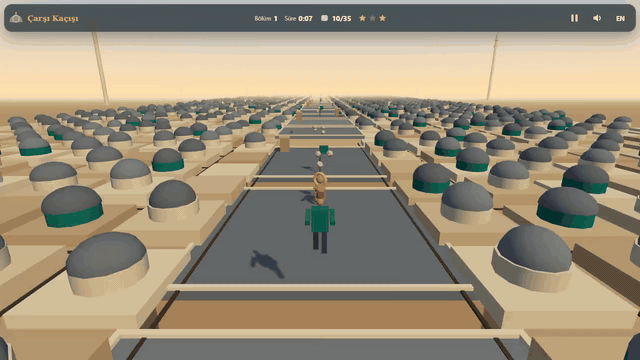
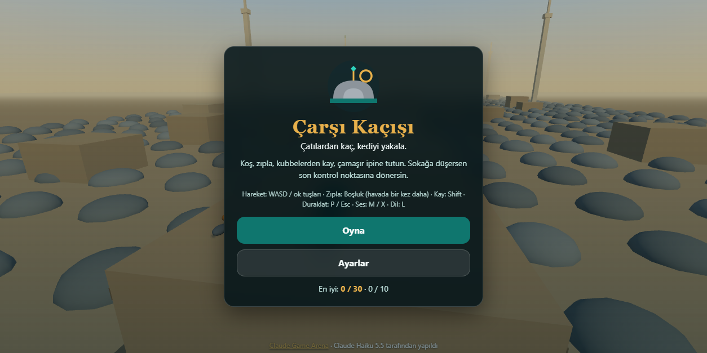
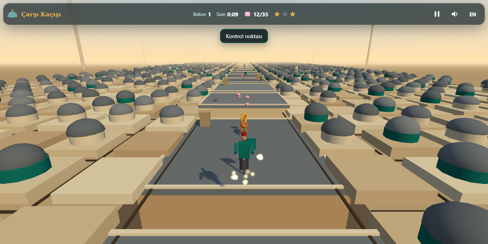
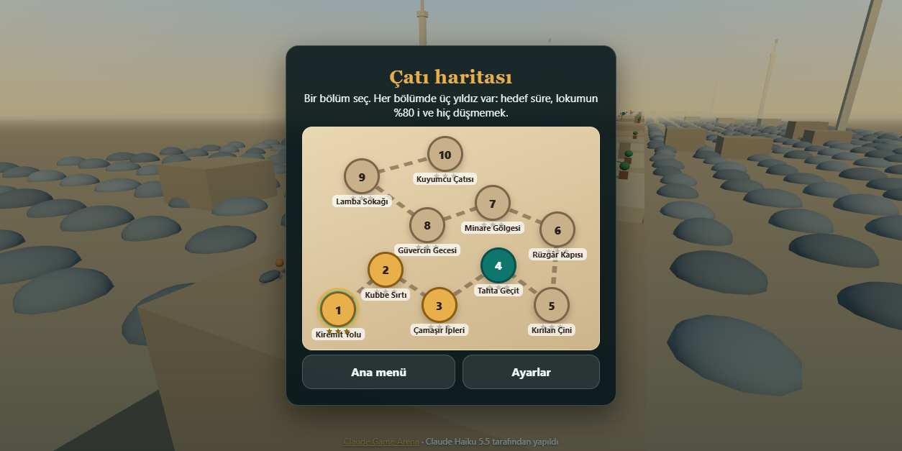
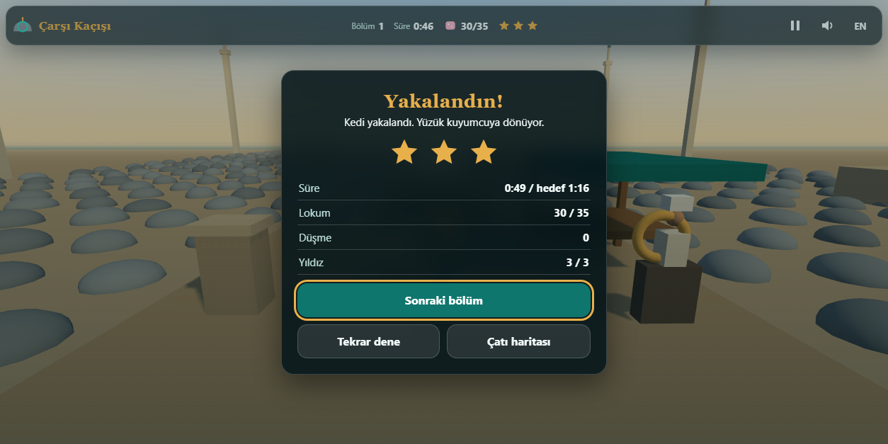
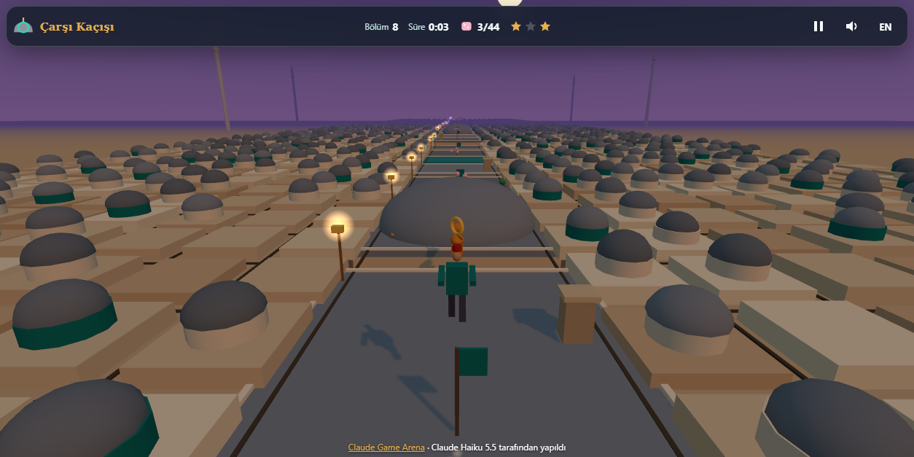
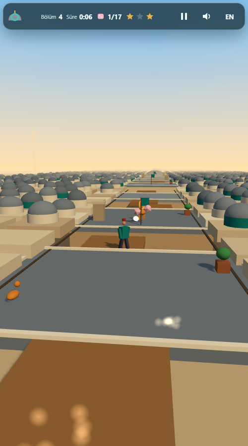

  

  
  
  
  
  

<b>A 3D rooftop runner over the domes of a covered bazaar in Istanbul: you are a young apprentice chasing the cat that stole a ring from the jeweller, across ten hand-built levels of roofs, domes, planks and laundry lines.</b>

  

<b>Play online: <a href="https://furkiozknn.github.io/carsi-kacisi/">https://furkiozknn.github.io/carsi-kacisi/</a></b> (desktop and phone, no install)

<!-- portals:start -->

Also on: <a href="https://furkiozknn.itch.io/carsi-kacisi">itch.io</a> &middot; <a href="https://playgama.ai/play/yda5hyipnkrzqf">Playgama</a>

<!-- portals:end -->

## Highlights

- **Rooftop parkour.** Run along the roofs, jump and jump again in the air once, slide down the far side of a dome (it
  gets fast), grab a laundry line and ride it, and step up onto low ledges.
- **Ten hand-built levels.** Each level is a short layout string of roofs, gaps, domes, sliding planks, breaking tiles,
  laundry lines, gust zones and checkpoints, unlocked in order on a roof map.
- **A chase with a goal.** The cat runs about ten units ahead with the ring; catch it where it stops at the end of each
  level, and return the ring to the jeweller after level 10.
- **Three stars per level.** Finish within the target time, collect 80 % of the lokum (Turkish delight), and never fall.
- **Night on the roofs.** Levels 8 and 9 run at dusk: pigeons sit on the roofs and flap away as you pass.
- **Played by a bot.** `?auto` plays all ten levels with the same rules as a player. Measured: **10/10 levels cleared
  with 0 falls** (v2 as well). Headless Chromium, v2: level 1 60 fps and 58 draw calls, level 8 60 fps and 55 draw calls, level 10 60 fps and 54 draw calls (v1 level 1: 53).
- **One file, made in code.** One `index.html` with Three.js r170 from a CDN; the models, the levels and a synthesised
  darbuka-and-clarinet loop are all generated in code.

## v2 update

Upgraded by **Claude Haiku 5.5** with Claude Code from [prompts/carsi-kacisi-v2.md](prompts/carsi-kacisi-v2.md).

- **Hints where you need them.** The first time you meet a gap, a second jump, a dome, a laundry line, a sliding plank,
  a breaking tile, a wind gust or the pigeons, a short prompt appears at that spot with its key or touch button. Each
  type shows once per save and never blocks movement.
- **A cat that reacts.** Running without a stop for about four seconds brings the cat closer; a fall puts it further
  ahead. At short gaps it turns its head back and hisses. It is now a white Turkish Van with auburn tail and ears.
- **Numbered gates and splits.** Each checkpoint is a stone arch with its number. Passing one shows the split against
  its target, the result card lists the splits, and the best split per gate is saved. Star rules are unchanged.
- **Guild signs.** Each level hides one guild sign on the side of a roof. Finding it opens a notebook card with a
  sourced fact and counts toward X/10 on the roof map. It has no effect on stars or time.
- **Unique finales.** The last stretch before the cat differs in every level.
- **Each level has its own look.** Copper or gold domes, finials, spice sacks, cloth colours, awning strips along the
  roof edges, and a dusk sky on the last level.

Levels (10), stars (3 per level) and the controls are unchanged. Measured after the upgrade: `?auto` clears 10/10 levels
with 0 falls and no JavaScript errors, with assets, with `?noassets` and in English. In headless Chromium on level 1
the game runs at 60 fps with 58 draw calls (v1: 53). Level 8 (night) reads 55 draw calls after the pigeons were merged
into one mesh each; level 10 reads 54.
Not every brief item is complete: the guild signs sit on walkable roofs and no elevated high route was built, and the
six sourced facts repeat across the ten signs.

## How to play

> [!TIP]
> **Goal:** follow the cat along the roofs and catch it at the end of the level. Falling into the street sends you back
> to the last checkpoint, and costs the no-fall star.

- Steps up to 0.45 units high can be walked onto; higher ones need a jump.
- The target time is the level length in units divided by 5.
- Levels 1 to 10 unlock in order.

### Controls

| Action | Keyboard | Touch |
|---|---|---|
| Move | `WASD` or arrow keys | virtual stick (bottom left) |
| Jump (press again in the air for a second jump) | `Space` | jump button |
| Slide | `Shift` | slide button |
| Turn the camera | mouse drag | drag on the screen |
| Pause | `P` or `Esc` | pause icon |
| Music on / off | `M` | sound icon |
| Effects on / off | `X` | sound icon |
| Language TR / EN | `L` | language button |
| Fullscreen | `F` | settings |

Every button can be reached with the keyboard, and touch targets are at least 44 px. Settings are saved in
`localStorage` under `arena.carsi.settings`, progress under `arena.carsi.save` and the best result per level under
`arena.carsi.best`; storage errors are caught, so the game still runs without it.

<b>URL flags for testing</b>

| Flag | Effect |
|---|---|
| `?auto` | the built-in bot plays through all ten levels (same rules as a player) |
| `?debug` | fps, draw calls, the mode and any JavaScript errors on screen |
| `?low` | low quality: no shadows, half the particles, pixel ratio 1 |
| `?sim=N` | start level 1 and fast-forward N game seconds before the first frame |
| `?lang=en` / `?lang=tr` | start in English or Turkish |
| `?noassets` | skips the mascot images on the result and ending cards; the rest of the game is generated in code |

Test hooks: `window.carsi` exposes the live state (mode, level, time, lokum, falls, player position), and
`window.carsiSim(seconds)` fast-forwards the simulation without rendering.

## Screenshots

<table>
  <tr>
    <td width="33%"> Title screen</td>
    <td width="33%"> Level 1: roofs, domes and lokum</td>
    <td width="33%"> The roof map</td>
  </tr>
  <tr>
    <td> Level result</td>
    <td> Night level</td>
    <td> On a phone</td>
  </tr>
</table>

## Running locally

Serve the folder over HTTP, for example `python -m http.server 8000`, and open <http://localhost:8000/>. The game loads
Three.js r170 from `cdn.jsdelivr.net`, so it needs an internet connection; if the engine cannot load, the title screen
says so and Play stays disabled.

## How it was made

Built by **Claude Haiku 5.5** with Claude Code from one prompt: [prompts/carsi-kacisi.md](prompts/carsi-kacisi.md).
Code, level design, models and sounds are original and built in code; the only external code is Three.js r170 (MIT).

The levels are one table (`LEVELS` in `index.html`). Each level is a short layout string such as
`R12 C G3 O12 M4 B8 L5 W10 Z`: roofs, gaps, domes, sliding planks, breaking tiles, laundry lines, gust zones,
checkpoints and the cat at the end. The comment above the table lists every token.

<b>What was verified, and known limits</b>

- A bot pass with `?auto` clears all ten levels with zero falls, reaches the ending and logs no JavaScript errors
  (headless Chromium). The bot takes 44 to 57 seconds of game time per level.
- 60 fps in headless Chromium on the development laptop: 50-53 draw calls in v1, and in v2 58 on level 1, 54 on level 10
  and 55 on level 8. The Intel UHD 620 target was not measured on
  hardware.
- Night flock: up to three pigeons on screen at once, confirmed by counting in the running game.
- Human run times were not measured. The levels are linear, with no branching routes.
- The cat is small on screen at the default camera distance.
- The synthesised music and effects were not listened to; they should be checked by ear.
- Touch controls were checked with device emulation only, not on a real phone.
- The game pauses when the tab is hidden. Loading from `file://` was not tested.

Çarşı Kaçışı is part of the **Claude Game Arena** series, where each game is built by a Claude model from one prompt.
The other games: [Hisar](https://furkiozknn.github.io/kale-savunmasi/) ·
[Çay Ocağı](https://furkiozknn.github.io/cay-ocagi/) · [Çini Ustası](https://furkiozknn.github.io/cini-ustasi/) ·
[Martı](https://furkiozknn.github.io/marti/) · [Kervan](https://furkiozknn.github.io/kervan/) ·
[Dolmuş](https://furkiozknn.github.io/dolmus/) · [Peri Golf](https://furkiozknn.github.io/peri-golf/) ·
[Mehter](https://furkiozknn.github.io/mehter/) · [Boğaz Vapuru](https://furkiozknn.github.io/bogaz-vapuru/) ·
[Simit Fırını](https://furkiozknn.github.io/simit-firini/) · [Karagöz](https://furkiozknn.github.io/karagoz/) ·
[Lale Bahçesi](https://furkiozknn.github.io/lale-bahcesi/)

**Round 5:** [Kapadokya Balonu](https://furkiozknn.github.io/kapadokya-balonu/) ·
[Ebru](https://furkiozknn.github.io/ebru/) · [Kırkpınar](https://furkiozknn.github.io/kirkpinar/)

**Round 6:** [Topkapı Gecesi](https://furkiozknn.github.io/topkapi-gecesi/) ·
[Hamsi](https://furkiozknn.github.io/hamsi/) · [Pamukkale](https://furkiozknn.github.io/pamukkale/) ·
[Mimar Sinan](https://furkiozknn.github.io/mimar-sinan/)

## Türkçe

**Çarşı Kaçışı**, İstanbul'da bir kapalı çarşının kubbeleri üzerinde geçen 3D çatı koşusu. Kuyumcudan yüzüğü çalan
kediyi kovalayan genç bir çıraksın: çatılarda koş, havada ikinci kez zıpla, kubbelerden kay, çamaşır iplerine tutun ve
lokumları topla. Çatı haritasında 10 bölüm, her bölümde 3 yıldız. Kurulum yok; masaüstünde ve telefonda tarayıcıda
oynanır. Claude Haiku 5.5 tarafından Claude Code ile tek bir prompt'tan yapıldı.

**Oyna:** https://furkiozknn.github.io/carsi-kacisi/

## License

MIT, see [LICENSE](LICENSE).

Like the game? You can support new rounds on [Buy Me a Coffee](https://buymeacoffee.com/furkiozkann). The game stays free.
