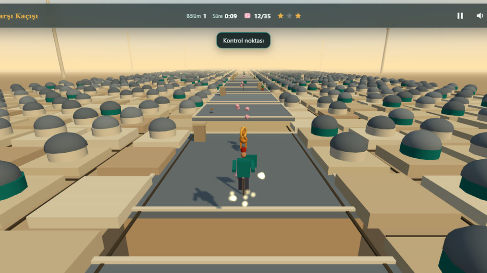
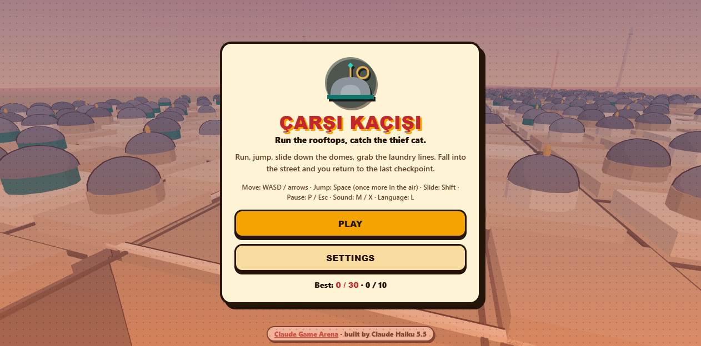
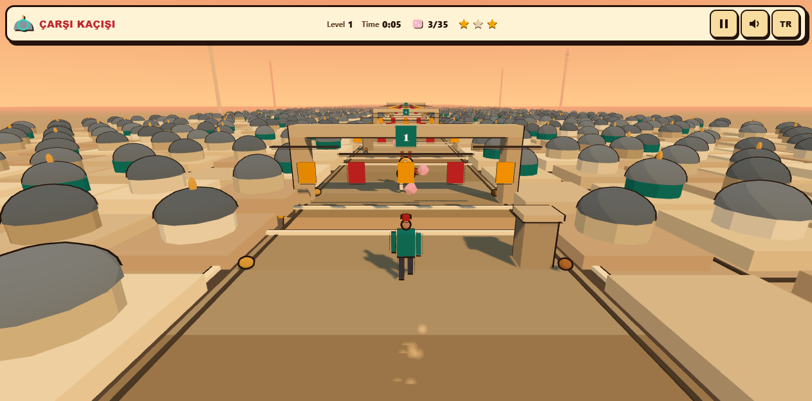
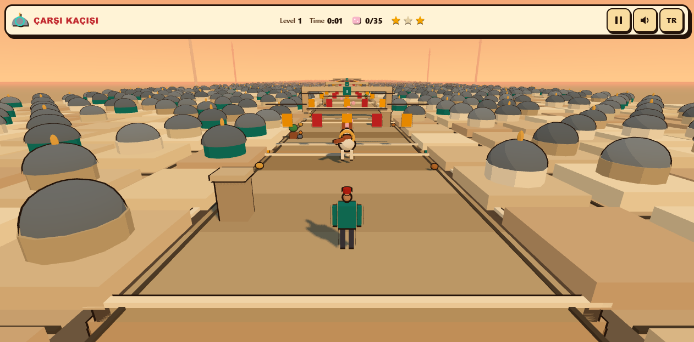
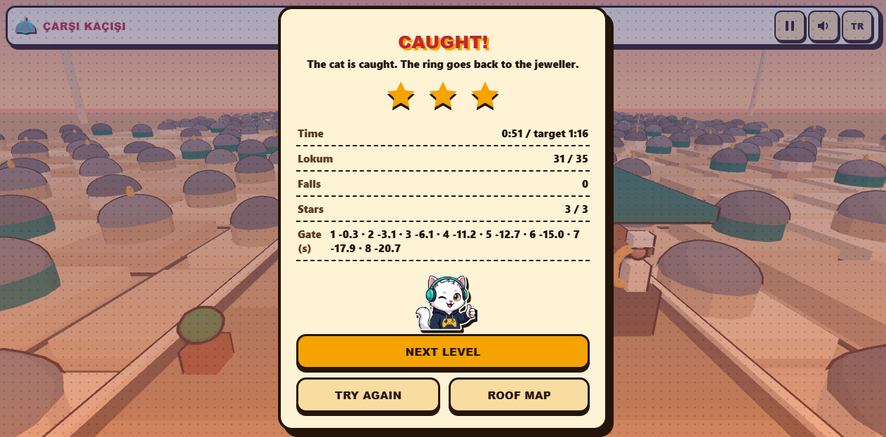
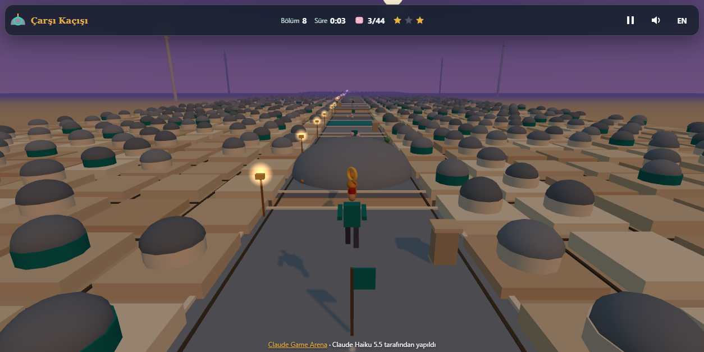
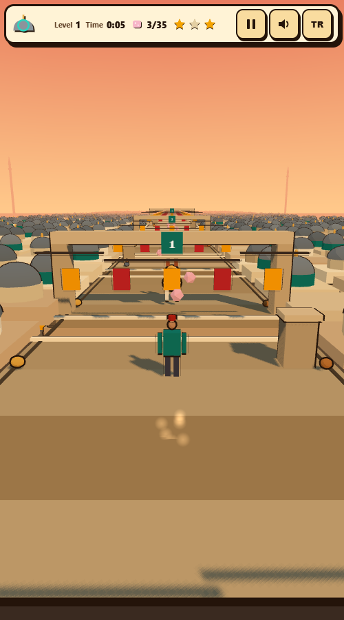

<p align="center">
  <a href="https://furkiozknn.github.io/carsi-kacisi/">
    
  </a>
</p>

<p align="center">
  <a href="https://furkiozknn.github.io/carsi-kacisi/"></a>
</p>

<p align="center">
  
  
  <a href="LICENSE"></a>
  
</p>

<!-- portals:start -->
<p align="center">
  Also on: <a href="https://furkiozknn.itch.io/carsi-kacisi"><strong>itch.io</strong></a> &middot; <a href="https://playgama.ai/play/yda5hyipnkrzqf"><strong>Playgama</strong></a>
</p>
<!-- portals:end -->

<p align="center">
  <strong>A 3D rooftop runner over the domes of a covered bazaar in Istanbul: you are a young apprentice chasing the cat that stole a ring from the jeweller, across ten hand-built levels of roofs, domes, planks and laundry lines.</strong>
</p>

<!-- gameplay gif -->

## Features

- **Ten hand-built levels & rooftop chase:** Run, double jump in the air, slide down domes, and ride laundry lines across 10 levels on a roof map, chasing the Van cat with the ring 10 units ahead to return it to the jeweller after level 10.
- **Three stars & numbered gate splits:** Earn 3 stars per level (finish within target time, collect 80% of lokum, 0 falls); pass numbered stone arch gates with real-time split toasts, saved best splits, and hidden guild signs (X/10) with 6 sourced historical facts.
- **Adaptive cat & contextual hints:** Running without stopping for about 4 seconds brings the cat closer while falls set you back; contextual hint prompts appear the first time you encounter a gap, second jump, dome, laundry line, sliding plank, breaking tile, wind gust, or pigeons.
- **Zincir Tezgâh (Stall Chain):** Run into a market stall on the roofs to topple it (slide into it with `Shift` to kick the goods further). The spilled fruit trips the cat for a moment, so it slows down and drops back toward you. It never comes closer than the usual 5 units, so you still catch it at the goal. Topple stalls within 2.6 seconds of each other to build a chain: the HUD counts the stalls and shows a ×N combo, with a toast in Turkish or English. Stalls have no collision, so standing or toppled they never block the path.
- **Night levels & dynamic obstacles:** Levels 8 and 9 run at dusk with up to 3 pigeons flapping away from roofs, breaking tiles, sliding planks, and wind gust zones.
- **Ultra-lean web performance:** A single `index.html` running Three.js r170 delivering 60 fps at 52–58 draw calls (level 1: 58, level 8: 55–56, level 10: 52–54; limit ~65), verified by an automated bot clearing 10/10 levels with 0 falls and 0 JS errors.

## How to play

> [!TIP]
> **Goal:** Follow the cat along the roofs and catch it at the end of each level. Falling into the street sends you back to the last checkpoint and costs the no-fall star.

1. **Sprint & leap:** Run across the rooftops (`WASD` or arrow keys) and time your jumps (`Space`). Press jump again in mid-air for a second jump to clear wide gaps.
2. **Slide & ride:** Hold `Shift` to slide down steep domes (gaining speed), walk onto low ledges (up to 0.45 units), or grab overhead laundry lines to glide across alleys.
3. **Pace the chase:** Run steadily for ~4 seconds to close in on the cat. Watch out for breaking tiles, sliding planks, and sudden wind gusts.

<details>
<summary><b>Rules and scoring</b></summary>

- **Three stars per level:**
  - *Target time:* Level length in units divided by 5.
  - *Lokum:* Collect at least 80% of the Turkish delight along the route.
  - *Clean run:* Finish without falling into the street (0 falls).
- **Checkpoints & splits:** Passing numbered stone arch gates records your gate split against the target time and updates your saved personal best.
- **Guild signs:** Each level hides 1 guild sign on the side of a roof with a sourced historical fact (6 sourced facts across the 10 signs, counting toward X/10 on the roof map).
- **Progression:** Levels 1 to 10 unlock sequentially on the roof map; catch the cat on level 10 to return the ring to the jeweller.

</details>

### Controls

| Action | Keyboard | Touch |
|---|---|---|
| Move | `WASD` or arrow keys | Virtual stick (bottom left) |
| Jump (press again in the air for a second jump) | `Space` | Jump button |
| Slide | `Shift` | Slide button |
| Turn the camera | Mouse drag | Drag on the screen |
| Pause | `P` or `Esc` | Pause icon |
| Music on / off | `M` | Sound icon |
| Effects on / off | `X` | Sound icon |
| Language TR / EN | `L` | Language button |
| Fullscreen | `F` | Settings |

- **Touch:** Virtual stick (bottom left) and jump/slide buttons (touch targets at least 44 px).
- **Persistence:** Settings (master / music / effects volume, mute, TR / EN, Low / High quality, fullscreen) are saved in `localStorage` under `arena.carsi.settings`; level progress under `arena.carsi.save` and best results per level under `arena.carsi.best` (storage errors are caught, so the game still runs without it). Turkish is the default language.

<details>
<summary><b>URL flags for testing</b></summary>

| Flag | Effect |
|---|---|
| `?auto` | The built-in bot plays through all ten levels (same rules as a player) |
| `?debug` | FPS, draw calls, mode, and any JavaScript errors on screen |
| `?low` | Low quality: no shadows, half particles, pixel ratio 1 |
| `?sim=N` | Start level 1 and fast-forward N game seconds before the first frame |
| `?lang=en` / `?lang=tr` | Start in English or Turkish |
| `?noassets` | Skips mascot images on result and ending cards; the rest of the game is generated in code |

`window.carsi` exposes the live state (mode, level, time, lokum, falls, player position); `window.carsiSim(seconds)` fast-forwards the simulation without rendering.

</details>

## Screenshots

<table>
  <tr>
    <td width="33%"><br><sub>Title screen</sub></td>
    <td width="33%"><br><sub>Level 1: roofs, domes and lokum</sub></td>
    <td width="33%"><br><sub>The roof map</sub></td>
  </tr>
  <tr>
    <td><br><sub>Level result</sub></td>
    <td><br><sub>Night level</sub></td>
    <td><br><sub>On a phone</sub></td>
  </tr>
</table>

## Redesign & Performance

**Art direction:** Cel-shaded rooftop look with a three-step toon ramp, ink outlines on the runner, the cat, the domes and the arches, a dusk sky, saffron awnings and spice-red bunting. The UI is a comic paper skin with chunky outlines.

**Visual updates (rules, controls, bot, and saves are untouched):**
- **Scene & materials:** Toon materials and inverted-hull outlines, dusk sky and fog, bunting and awning colour, speed FOV on the chase camera.
- **UI:** Comic panels and buttons on every screen, responsive phone HUD.

**Measured on an Intel UHD 620 target budget (headless Chromium, 1280x720):**
- Draw calls: level 1 58, level 8 56, level 10 52 (limit ~65)
- Page rAF: 60 fps
- `?auto` clears 10/10 levels with 0 JavaScript errors, with assets and with `?noassets`; `?lang=en` shows 0 errors

## Running locally

Serve the folder over HTTP (ES modules do not load from `file://`):

```bash
python -m http.server 8000
```

Then open <http://localhost:8000/>. Three.js r170 loads from `cdn.jsdelivr.net` (internet connection required; if the engine cannot load, the title screen notifies and Play stays disabled).

## Made with Claude Code

Built by **Claude Haiku 5.5** with Claude Code from one prompt: [prompts/carsi-kacisi.md](prompts/carsi-kacisi.md). Code, level design, models and sounds are original and built in code; Three.js is loaded from jsDelivr under its MIT licence.

### v2 update

Upgraded by **Claude Haiku 5.5** with Claude Code from [prompts/carsi-kacisi-v2.md](prompts/carsi-kacisi-v2.md): hints where you need them, an adaptive Van cat, numbered stone arch gates with split toasts, guild signs with sourced historical facts, unique finales, and per-level visual styling. Counts are unchanged (10 levels, 3 stars per level, the same controls).

- **Hints where you need them:** The first time you meet a gap, a second jump, a dome, a laundry line, a sliding plank, a breaking tile, a wind gust or the pigeons, a short prompt appears at that spot with its key or touch button. Each type shows once per save and never blocks movement.
- **A cat that reacts:** Running without a stop for about four seconds brings the cat closer; a fall puts it further ahead. At short gaps it turns its head back and hisses. It is now a white Turkish Van with auburn tail and ears.
- **Numbered gates and splits:** Each checkpoint is a stone arch with its number. Passing one shows the split against its target, the result card lists the splits, and the best split per gate is saved. Star rules are unchanged.
- **Guild signs:** Each level hides one guild sign on the side of a roof. Finding it opens a notebook card with a sourced fact and counts toward X/10 on the roof map. It has no effect on stars or time.
- **Unique finales & distinct themes:** The last stretch before the cat differs in every level. Copper or gold domes, finials, spice sacks, cloth colours, awning strips along the roof edges, and a dusk sky on the last level.

<details>
<summary><b>Technical notes & verified limits</b></summary>

- **Level parser (`LEVELS`):** Compact layout strings encode geometry, obstacles, and checkpoints into tokens (`R` roofs, `C` cat, `G` gaps, `O` domes, `M` sliding planks, `B` breaking tiles, `L` laundry lines, `W` gust zones, `Z` checkpoints).
- **Bot verification:** A bot pass with `?auto` clears all ten levels with zero falls, reaches the ending, and logs 0 JavaScript errors (headless Chromium, 44 to 57 seconds game time per level).
- **Draw calls & frame rate:** 60 fps in headless Chromium: 50–53 draw calls in v1; 58 on level 1, 55 on level 8 (pigeons merged into one mesh each), and 54 on level 10 in v2 (within the ~65 UHD 620 target budget).
- **Atmospheric effects:** Night flock spawns up to 3 pigeons on screen at once; dusk lighting and wind zone particle effects.
- **Audio (Web Audio only):** Synthesised darbuka-and-clarinet loop and sound effects generated entirely in code.

</details>

### Claude Game Arena

Çarşı Kaçışı is part of the **Claude Game Arena** series, where each game is built by a Claude model from one prompt.

[Hisar](https://furkiozknn.github.io/kale-savunmasi/) · [Çay Ocağı](https://furkiozknn.github.io/cay-ocagi/) · [Çini Ustası](https://furkiozknn.github.io/cini-ustasi/) · [Martı](https://furkiozknn.github.io/marti/) · [Kervan](https://furkiozknn.github.io/kervan/) · [Dolmuş](https://furkiozknn.github.io/dolmus/) · [Peri Golf](https://furkiozknn.github.io/peri-golf/) · [Mehter](https://furkiozknn.github.io/mehter/) · [Boğaz Vapuru](https://furkiozknn.github.io/bogaz-vapuru/) · [Simit Fırını](https://furkiozknn.github.io/simit-firini/) · [Karagöz](https://furkiozknn.github.io/karagoz/) · [Lale Bahçesi](https://furkiozknn.github.io/lale-bahcesi/)

**Round 5:** [Kapadokya Balonu](https://furkiozknn.github.io/kapadokya-balonu/) · [Ebru](https://furkiozknn.github.io/ebru/) · [Kırkpınar](https://furkiozknn.github.io/kirkpinar/)

**Round 6:** [Topkapı Gecesi](https://furkiozknn.github.io/topkapi-gecesi/) · [Hamsi](https://furkiozknn.github.io/hamsi/) · [Pamukkale](https://furkiozknn.github.io/pamukkale/) · [Mimar Sinan](https://furkiozknn.github.io/mimar-sinan/)

## License

MIT, see [LICENSE](LICENSE).

Like the game? You can support new rounds on [Buy Me a Coffee](https://buymeacoffee.com/furkiozkann). The game stays free.
